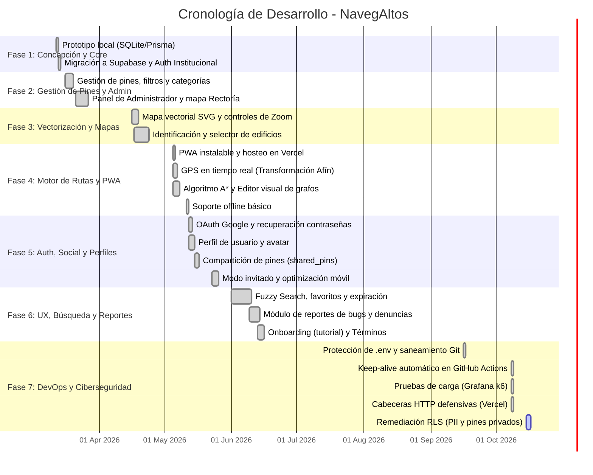

# 📅 Cronograma y Diagrama de Gantt del Proyecto NavegAltos

**Proyecto:** NavegAltos (Sistema de Navegación y Localización Campus)  
**Fuente de Datos:** Historial analítico de commits de Git (Marzo 2026 – Octubre 2026)  
**Fecha de Generación:** 15 de Octubre, 2026  

---

## 1. Diagrama de Gantt General

---

## 2. Desglose Detallado por Etapas y Fechas Clave

| Fase | Fechas | Hitos Principales |
| :--- | :---: | :--- |
| **1. Prototipado e Infraestructura** | **12 Mar – 14 Mar** | Creación del frontend base, descarte de SQLite/Prisma local y adopción definitiva de **Supabase** para gestión cloud y autenticación institucional. |
| **2. Pines y Panel Admin** | **16 Mar – 27 Mar** | Filtros por categorías, pines públicos vs privados, creación del panel de administración para moderación de ubicaciones y soporte inicial para el edificio de Rectoría. |
| **3. Vectorización y Rendimiento** | **16 Abr – 24 Abr** | Reemplazo de imágenes estáticas por **mapa vectorial SVG** optimizado para evitar caídas de FPS, incorporación de zoom suave y selector de edificios. |
| **4. Navegación, Rutas y PWA** | **05 May – 12 May** | Implementación del algoritmo de rutas **A-Star (A*)**, calibración de **GPS en tiempo real** con matriz afín, editor de grafos de rutas con Modo Zen y conversión a **PWA instalable**. |
| **5. Autenticación y Perfiles** | **12 May – 26 May** | Login con Google OAuth, perfiles de usuario con foto, sistema de compartición de pines con enlaces temporales (`shared_pins`) y modo invitado. |
| **6. Búsqueda y Usabilidad** | **01 Jun – 16 Jun** | Algoritmo de búsqueda difusa (*Fuzzy Search* con fuse.js), pines favoritos, sistema de reporte de fallos (`system_bugs`), onboarding interactivo (tutorial guiado) y términos legales. |
| **7. Infraestructura y Ciberseguridad** | **16 Sep – Actualidad** | Eliminación de credenciales en Git, temporizador **Keep-Alive con GitHub Actions**, pruebas de estrés con **Grafana k6** (100% de éxito), cabeceras HTTP de seguridad y **blindaje de RLS en base de datos**. |

---

## 3. Estado Actual de la Línea de Tiempo

* **Fecha actual:** 15 de Octubre, 2026
* **Hito en curso:** Fase 7 (Cierre de brechas críticas: PII en `profiles` y función RPC en `shared_pins`).
